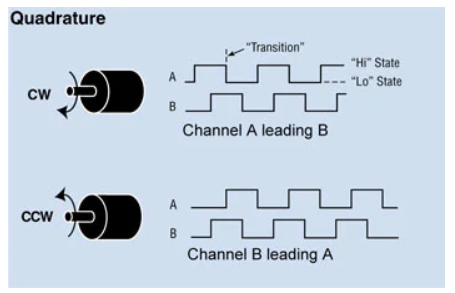

# Opdracht 4: Producers, consumers en queues in FreeRTOS

In dit practicum komt het volgende FreeRTOS-onderwerp aan bod:

- Het gebruik van queues voor communicatie tussen tasks

Daarnaast komen vanwege de toepassing in projecten in combinatie met FreeRTOS ook de volgende twee onderwerpen aan bod:

- Het genereren van analoge signalen met een digitaal-analoogconverter (DAC)
- Het bepalen van posities met een quadratuur-encoder

## 4.1 Producers, consumers en queues

In voorgaande practica werd data tussen tasks uitgewisseld met globale variabelen, of werd een gemeenschappelijke globale variabele door twee of meer tasks gewijzigd. Iedere task kan een globale variabele lezen en/of schrijven. Dat betekent dat de toegang tot zo'n variabele altijd moet worden afgeschermd met bijvoorbeeld een mutex. Een groot nadeel, of beter gezegd probleem, is dat elke variabele door alle tasks kan worden gewijzigd.

Uitwisseling van data tussen tasks in FreeRTOS kan efficiënter en veiliger worden geïmplementeerd met zogenoemde queues (wachtrijen). Aan een queue kan data worden toegevoegd door een zogenoemde *producer* (producent van data). De data wacht vervolgens in de queue op verwerking door een zogenoemde *consumer* (gebruiker van data).

In dit practicum is de producer een task die de ADC uitleest en de ADC-meetwaarden in een queue zet. De consumer is een task die wacht totdat er een vooraf vastgesteld aantal meetwaarden in de queue staat en vervolgens het gemiddelde van die meetwaarden bepaalt.

Daarnaast wordt een task gemaakt die de queue monitort en continu laat zien hoeveel data, in dit geval ADC-meetwaarden, in de queue staat.

Open in Visual Studio Code de folder/map `<path-to-your-project>/workspace/assignments/4_1_queue_framework`.

:::{warning}
Voeg uitsluitend code toe aan, of wijzig code in, het bestand `src/main.cpp`. Alle overige folders bevatten bestanden voor de systeemconfiguratie en bibliotheken. Laat deze **ongewijzigd**.
:::

:::{admonition} Opdracht 4.1.1
:class: tip

- Declareer een globale handle van het type `QueueHandle_t` met de naam `handle_Queue`.
- Maak hiermee een queue met de functie `xQueueCreate()` in de functie `StartUserTasks`. In deze queue worden de meetwaarden van de ADC opgeslagen. Deze meetwaarden zijn spanningen in volt van het type `double`, zoals teruggegeven door `adc.ReadVoltage()`.
  Het aantal elementen in de queue (de "grootte") staat in de variabele `queueSize` en is 5. De grootte van elk element in deze queue, uitgedrukt in het aantal bytes, kan compile-time worden uitgerekend met de `sizeof`-operator. Zo geeft `sizeof(double)` als resultaat het aantal bytes in een variabele van het type `double` (op de ESP32 is dat 8).
- Voeg aan de task `TaskProducer` de volgende oneindige herhaling toe:
  - Meet de spanning van ADC-kanaal 4 (potmeter RV1/P0) met `adc.ReadVoltage()`.
  - Bepaal of de queue vol is. Gebruik hiervoor de functie `uxQueueSpacesAvailable`. Geef een melding in de Terminal als de queue vol is.
  - Zet de gemeten waarde in de queue. Gebruik hiervoor de functie `xQueueSend`. Als de queue vol is, blijft `xQueueSend` wachten (indien nodig oneindig lang, met `portMAX_DELAY`) totdat er weer plaats is, waardoor deze waarde uiteindelijk toch in de queue wordt gezet.
  - Wacht vervolgens een halve seconde (500 ms).
- Voeg aan de task `TaskConsumer` de volgende oneindige herhaling toe:
  - Wacht totdat de queue `nrOfSamples` (= 5) meetwaarden bevat. Gebruik hiervoor de functie `uxQueueMessagesWaiting`. Dit is alleen ter illustratie: deze constructie is niet erg efficiënt, omdat er actief wordt gewacht. Zorg er wel voor dat de task tijdens het wachten met `vTaskDelay` de CPU vrijgeeft.
  - Zodra deze 5 meetwaarden beschikbaar zijn: lees ze met `xQueueReceive` uit de queue, bereken het gemiddelde en laat het resultaat in de Terminal zien.
:::

Om regelmatig weer te geven hoeveel elementen in de queue staan, wordt een monitor-task toegevoegd die elke 200 ms het aantal elementen in de Terminal weergeeft. Deze task wijzigt de inhoud van de queue dus niet, maar geeft uitsluitend de status weer.

:::{admonition} Opdracht 4.1.2
:class: tip
Breid de code in de functie `TaskMonitor` zodanig uit dat elke 200 ms het aantal elementen in de queue wordt weergegeven. Gebruik hiervoor de functie `uxQueueMessagesWaiting`.
:::

In bovenstaande opdracht raakt de queue nét vol: zodra de producer vijf meetwaarden in de queue heeft gezet, leest de consumer deze weer uit. De queue is dus weer leeg als de volgende meetwaarde beschikbaar komt.

:::{admonition} Opdracht 4.1.3
:class: tip
Wijzig de code in ofwel de consumer-task, ofwel de producer-task zodanig dat de queue vol raakt en de bijbehorende melding van de producer-task in de Terminal verschijnt. Controleer ook of de monitor-task laat zien dat de queue dan het maximale aantal elementen bevat.
:::

## 4.2 Genereren van een analoog signaal met een DAC

Analoge signalen in een mechatronisch regelsysteem, bijvoorbeeld voor de aansturing van een motor, worden gemaakt met een digitaal-analoogconverter (DAC). Het NodeMCU-Shield bevat vier analoge uitgangskanalen, waarvan de spanning instelbaar is tussen -10 volt en +10 volt. Deze spanning wordt gegenereerd door twee 12-bits DAC's (MCP4922, elk met twee kanalen) met bijbehorende uitgangsversterkers, zie figuur 1.

*Figuur 1. Digitaal-analoogconverter (DAC)*

De relatie tussen de digitale 12-bits ingangswaarde $N$ van de DAC en de uitgangsspanning $V_{out}$ wordt gegeven door:

$$
V_{out} = -10 + \frac{N}{4096} \cdot 20\ \mathrm{V}, \qquad 0 \leq N \leq 4095
$$

De minimale uitgangsspanning is -10,000 volt voor $N = 0$. De maximale uitgangsspanning is 9,995 volt voor $N = 4095$, dus net geen +10 volt. Voor $N = 2048$ is de uitgangsspanning uiteraard 0 volt. In de [DAC-bibliotheek](libraries/dac_4922_lib.md) zijn deze grenzen beschikbaar als `DAC_MIN_VOLTAGE` en `DAC_MAX_VOLTAGE`.

In de volgende opdracht wordt de DAC aangestuurd om een analoge golfvorm te maken op DAC-kanaal 0. De uitgangsspanning van DAC-kanaal 0 (`VOUT0`) is beschikbaar op de DE9-connector `J5` van het NodeMCU-Shield (zie het [schema](../images/NodeMCU32SPlatform_v2.pdf)). Sluit hierop een oscilloscoop aan om het signaal te bekijken.

:::{note}
De DAC heeft een settling time van enkele microseconden en de uitgangsversterker heeft een eindige slew rate. Opeenvolgende DAC-waarden mogen daarom niet te snel achter elkaar naar de DAC worden gestuurd; anders worden ze niet correct omgezet naar de bijbehorende analoge uitgangsspanning. Gebruik tussen twee stappen bijvoorbeeld `vTaskDelay(pdMS_TO_TICKS(1))`. De Arduino-functie `delayMicroseconds()` kan ook, maar maakt **geen** gebruik van de FreeRTOS-scheduler: de task blijft dan actief wachten en geeft de CPU niet vrij.
:::

Open in Visual Studio Code de folder/map `<path-to-your-project>/workspace/assignments/4_2_dac_framework`.

:::{admonition} Opdracht 4.2.1
:class: tip

- Maak gebruik van de voorgedefinieerde functie `TaskDAC`.
- Sluit een oscilloscoop aan op de uitgang van DAC-kanaal 0 om het DAC-signaal te bekijken.
- Implementeer in de functie `TaskDAC` de volgende oneindige herhaling voor DAC-kanaal 0:
  - Verhoog stapsgewijs de uitgangsspanning van -10 volt tot het maximum van +10 volt.
  - Verlaag daarna stapsgewijs de uitgangsspanning van +10 volt weer naar -10 volt.

  Maak hierbij gebruik van de voorgedefinieerde variabele `stepSize`; deze bevat de stapgrootte in volt. Dit resulteert in een driehoekvormige uitgangsspanning. Experimenteer eventueel ook met andere signalen, bijvoorbeeld een blokgolf of een zaagtand.

**Aanwijzingen**

- Het eenvoudigst is het gebruik van de member-functie `dac.SetOutputVoltage(dacChannel, voltage)`. Deze heeft als parameters het DAC-kanaalnummer en de gewenste uitgangsspanning.
- Voor de liefhebbers: er mag ook gebruik worden gemaakt van de member-functie `dac.Write(dacChannel, N)`, met als parameters het kanaalnummer en de 12-bits DAC-waarde $N$.
:::

## 4.3 Nauwkeurige positiebepaling met een quadratuur-encoder

Voor het bepalen van posities bij bewegende mechatronische systemen wordt vaak gebruikgemaakt van zogenoemde quadratuur-encoders of positieopnemers. Deze encoders genereren tijdens een beweging twee digitale signalen. De onderlinge fase van deze signalen geeft de draai- of bewegingsrichting aan, bijvoorbeeld linksom of rechtsom, zie figuur 2.

De positie van een as of opnemer wordt weergegeven door de waarde van een teller. Afhankelijk van de draai- of bewegingsrichting wordt de teller met één verhoogd of verlaagd. Nauwkeurige hoek- en positiebepaling is mogelijk; typische waarden zijn bijvoorbeeld 5.000 counts per omwenteling.

*Figuur 2. Quadratuursignalen (bron: [Dynapar: Quadrature Encoder Basics](https://www.dynapar.com/technology/encoder_basics/quadrature_encoder/))*

Daarnaast levert een quadratuur-encoder meestal nog een zogenoemd indexsignaal, dat een specifieke positie markeert, bijvoorbeeld bij een volledige rotatie of bij het bereiken van een referentiepositie.

Het optellen en aftellen van deze quadratuursignalen wordt volledig in hardware uitgevoerd met specifieke IC's: op het NodeMCU-Shield zijn dat twee LS7366R-quadratuurtellers. De processor heeft hier geen bemoeienis mee. De software in FreeRTOS kan zich daarom beperken tot het eenmalig configureren en op geschikte momenten uitlezen van de waarden van de teller. Het moment van uitlezen wordt bepaald door de applicatie. Omdat het tellen in hardware gebeurt, worden er nooit counts gemist. Zie ook de [QC-bibliotheek](libraries/qc_7366_lib.md).

Omdat quadratuur-encoders meestal mechanisch aan een opstelling zijn gekoppeld, wordt in het practicum gebruikgemaakt van een quadratuur-interface. Hierbij wordt de encoder gesimuleerd met een draaiknop die de quadratuursignalen A en B genereert. Het indexsignaal wordt gegenereerd door de draaiknop in te drukken. Deze interface kan daarnaast ook worden gebruikt om rechtstreeks een quadratuur-encoder aan te sluiten.

Open in Visual Studio Code de folder/map `<path-to-your-project>/workspace/assignments/4_3_quadrature_framework`.

:::{admonition} Opdracht 4.3.1
:class: tip

- Sluit de quadratuur-interface met de bijbehorende kabel aan op de encoderconnector `J7` van het NodeMCU-Shield. Laat alle jumpers op de quadratuur-interface ongewijzigd. De groene LED op de quadratuur-interface gaat aan als de interface spanning heeft.
- Maak gebruik van de voorgedefinieerde functie `TaskQuadrature`.
- Het NodeMCU-Shield beschikt over twee onafhankelijke quadratuurkanalen (kanaal 0 en kanaal 1). Bij gebruik van de quadratuur-interface voor simulatie van de signalen krijgen BEIDE kanalen tegelijkertijd dezelfde A-, B- en INDEX-signalen aangeboden.
- Voeg code toe aan `TaskQuadrature`, zodat deze task elke seconde de tellerstand van het quadratuurkanaal `qcChannel` weergeeft:
  - Schrijf eenmalig de gegeven `mode` naar mode-register 0 van het gekozen kanaal met `qc.WriteModeRegister(qcChannel, QC_MODE_REGISTER_0, mode)`.
  - Gebruik daarna eenmalig de functie `qc.EnableCounter` om het gewenste quadratuurkanaal te enablen. Er is ook een functie `qc.DisableCounter` om dat kanaal weer (tijdelijk) te disablen.
  - Gebruik de functie `qc.ReadCountRegister` om elke seconde de tellerstand van het gewenste kanaal op te vragen.
  - Draai aan de knop (linksom/rechtsom) en bepaal wat er gebeurt met de waarde van de teller.
  - Druk de draaiknop in en bepaal wat er gebeurt met de waarde van de teller.
- Voeg vervolgens code toe om te bepalen of het indexsignaal is gezet (na het indrukken van de draaiknop):
  - Gebruik de functie `qc.IsIndexSet` om te bepalen of het indexsignaal is gezet. De teller onthoudt dit: het moet daarna worden gewist met de functie `qc.ClearStatusRegister`!
:::
