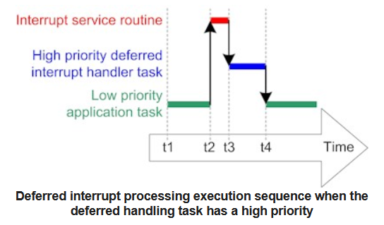

# Opdracht 5: Interrupts in FreeRTOS

In dit practicum komt het gebruik van interrupts in FreeRTOS aan bod. Er zijn drie opdrachten:

- In opdracht 5.1 wordt het principe van interrupts en de bijbehorende scheduling uitgelegd aan de hand van het indrukken van een drukknop.
- In opdracht 5.2 worden periodiek interrupts gegenereerd door een klokgenerator.
- In opdracht 5.3 worden periodieke interrupts gebruikt voor het uitvoeren van een lege control task. Daarnaast wordt een afzonderlijke task gebruikt voor het instellen van een parameter voor de control task.

## 5.1 Hardware-interrupts met een drukknop

Hardware-interrupts onderbreken de lopende programma-executie omdat er een externe gebeurtenis plaatsvindt, dus een gebeurtenis in de fysieke buitenwereld die onmiddellijk aandacht van de processor nodig heeft. Deze interrupts kunnen bijvoorbeeld afkomstig zijn van een extern device dat data beschikbaar heeft voor verwerking.

Door een interrupt kan de CPU op onvoorspelbare momenten worden onderbroken tijdens het uitvoeren van tasks. De code die direct en onmiddellijk moet worden uitgevoerd bij het afhandelen van een interrupt, heet een Interrupt Service Routine (ISR).

In FreeRTOS heeft een ISR een hogere prioriteit dan **elke** andere task. Dat betekent het volgende:

- Een ISR is **geen** FreeRTOS-task en kan niet worden geblokkeerd. In een ISR kan dus bijvoorbeeld niet op een queue, mutex of semafoor worden gewacht.
- Een ISR mag zichzelf niet blokkeren en mag dus geen potentieel oneindige herhalingen bevatten. Een ISR heeft een hogere prioriteit dan de scheduler en kan bij een oneindige herhaling ervoor zorgen dat het systeem vastloopt.
- Een ISR moet zo kort mogelijk zijn, zowel in tijd als in uitvoerbare code. In een ISR mogen alleen de hoogst noodzakelijke acties worden uitgevoerd. Welke acties dat zijn, hangt meestal af van het device dat de interrupt genereert.
- In een ISR mag slechts gebruik worden gemaakt van enkele speciale FreeRTOS-functies. Deze hebben de vorm `<functienaam>FromISR`. Andere FreeRTOS-functies mogen absoluut niet worden gebruikt, omdat het systeem anders kan crashen of vastlopen. Een voorbeeld van een FreeRTOS-functie die in een ISR wel mag worden gebruikt, is `xSemaphoreGiveFromISR`.
- Op de ESP32 wordt een ISR gemarkeerd met `IRAM_ATTR`, zodat de code in het interne RAM staat en snel kan worden uitgevoerd.

### 5.1.1 Deferred Interrupt Processing

Om een interrupt toch in een normale FreeRTOS-task te kunnen afhandelen, wordt gebruikgemaakt van *Deferred Interrupt Processing* (uitgestelde interruptafhandeling). Hierbij wordt de niet-tijdkritische verwerking van de data niet in de ISR zelf uitgevoerd, maar uitgesteld en verder afgehandeld in een normale FreeRTOS-task. Meestal heeft die task een hogere prioriteit dan alle andere (applicatie)tasks, maar per definitie een lagere prioriteit dan de interrupt.

Een ISR heeft daarom uitsluitend de volgende beperkte functionaliteit:

- Het afhandelen van de absoluut noodzakelijke acties, zoals het registreren van de interruptbron of -oorzaak en het wegnemen van de oorzaak van de interrupt. Dit hangt vaak af van het type device dat de interrupt genereert.
- Het signaleren aan de FreeRTOS-scheduler dat een interrupt is opgetreden en dat een FreeRTOS-task de data moet verwerken. Met andere woorden: de ISR zal meestal een task deblokkeren. Dit kan bijvoorbeeld met de functie `xSemaphoreGiveFromISR`.

Zie figuur 1 voor een voorbeeld van *Deferred Interrupt Processing* (bron: [FreeRTOS: Deferred Interrupt Processing](https://www.freertos.org/deferred_interrupt_processing.html)).



*Figuur 1. Deferred Interrupt Processing*

Als de FreeRTOS-task die de interrupt moet afhandelen een voldoende hoge prioriteit heeft ten opzichte van de overige tasks, wordt deze onmiddellijk uitgevoerd nadat de zeer korte ISR klaar is. Feitelijk wordt de verwerking van de interrupt aaneengesloten in de tijd uitgevoerd, alsof alle verwerking in de ISR zelf had plaatsgevonden. Zie figuur 1: alle interruptverwerking vindt plaats tussen de tijdstippen $t_2$ en $t_4$, ook al wordt een deel van de verwerking uitgevoerd door een task (het blauwe deel).

Op de ESP32 ziet een ISR die een task deblokkeert er in grote lijnen als volgt uit:

```cpp
void IRAM_ATTR interruptHandler(void)
{
    BaseType_t higherPriorityTaskWoken = pdFALSE;

    // ... hoogst noodzakelijke acties ...
    xSemaphoreGiveFromISR(handle_InterruptSemaphore, &higherPriorityTaskWoken);

    // laat de scheduler direct wisselen als er een task met hogere prioriteit is gedeblokkeerd
    portYIELD_FROM_ISR(higherPriorityTaskWoken);
}
```

Een ISR wordt aan een GPIO-pin gekoppeld met de Arduino-functie `attachInterrupt`. Deze functie koppelt de handler én zet de interrupt aan:

```cpp
pinMode(pin, INPUT_PULLUP);
attachInterrupt(digitalPinToInterrupt(pin), interruptHandler, FALLING);
```

### 5.1.2 Opdracht

Om inzicht te krijgen in de werking van interrupts, wordt in de volgende opdracht een interrupt gegenereerd door het indrukken van de drukknop op het NodeMCU-Shield die rechtstreeks op de ESP32 is aangesloten (`BUTTON_0` in de code, GPIO 4, zie ook de [knopbibliotheek](libraries/button_lib.md)). De andere knoppen zijn niet rechtstreeks op een GPIO-pin aangesloten en worden in deze opdracht niet gebruikt. Deze interrupt wordt afgehandeld door een ISR en een bijbehorende FreeRTOS-task. Als de knop wordt ingedrukt, gebeurt het volgende:

- De globale variabele `g_InterruptCount` wordt in de ISR met één verhoogd.
- Een FreeRTOS-task laat vervolgens de waarde van deze variabele zien, dus 1, 2, 3 enzovoort, en wordt geblokkeerd totdat de knop weer wordt ingedrukt.

Open in Visual Studio Code de folder/map `<path-to-your-project>/workspace/assignments/5_1_button_interrupts`.

:::{warning}
Voeg uitsluitend code toe aan, of wijzig code in, het bestand `src/main.cpp`. Alle overige folders bevatten bestanden voor de systeemconfiguratie en bibliotheken. Laat deze **ongewijzigd**.
:::

Zoek in het bestand `src/main.cpp` naar de tekenreeks `TODO` voor de bijbehorende aanwijzingen in de broncode.

:::{admonition} Opdracht 5.1.2
:class: tip

- In het framework is de task `TaskInterruptHandler` al gegeven. Dit is een FreeRTOS-task die wordt gestart in de functie `StartUserTasks`. Zorg ervoor dat deze op een voldoende hoge prioriteit wordt uitgevoerd.
- Declareer de globale variabele `g_InterruptCount` van het type `uint32_t` met beginwaarde 0.
- Declareer de globale handle `handle_InterruptSemaphore` van het type `SemaphoreHandle_t` met beginwaarde `NULL`. Dat betekent dat deze semafoor nog niet is geïnitialiseerd.
- Maak met deze globale handle een semafoor in de functie `TaskInterruptHandler`. Maak gebruik van de functie `xSemaphoreCreateCounting`. Bepaal de juiste waarden van de parameters voor deze functie aan de hand van de documentatie. Deze semafoor wordt gebruikt om vanuit de ISR de bijbehorende task te deblokkeren.
- Gegeven is de (nog niet complete) ISR-functie `interruptHandler`. Deze functie moet worden aangeroepen als de drukknop wordt ingedrukt. Let op: deze functie wordt "aangeroepen" door een hardware-event; het is dus **niet** mogelijk om deze rechtstreeks vanuit de programmacode aan te roepen zoals een gewone functie. De bijbehorende semafoor mag pas worden vrijgegeven nádat deze is geïnitialiseerd, vandaar de controle op `NULL` (anders kan het systeem crashen).
- Koppel de functie `interruptHandler` in de functie `TaskInterruptHandler` aan de drukknop met `attachInterrupt`:
  - Zet de pin eerst als ingang met `pinMode(BUTTON_0, INPUT_PULLUP)`.
  - Gebruik de flank `FALLING`: bij het indrukken van de knop vindt een overgang van HOOG naar LAAG plaats op de ingang van de microcontroller (vanwege de pull-up-weerstand). Als er een interrupt moet optreden bij het loslaten van de knop, moet `RISING` worden gebruikt.
  - Koppel de interrupt pas nadat de semafoor is aangemaakt.
- Pas de code in de functie `TaskInterruptHandler` zodanig aan dat deze het volgende doet:
  - Wacht op de semafoor die in de ISR wordt vrijgegeven.
  - Laat de waarde van `g_InterruptCount` zien zodra de knop is ingedrukt (dus 1, 2, 3 enzovoort) en wacht daarna totdat de knop weer wordt ingedrukt.
:::

:::{admonition} Opdracht 5.1.3
:class: tip
Druk een aantal keren op de knop. Neemt `g_InterruptCount` bij elke druk precies met één toe? Verklaar wat je ziet (denk aan *contactdender* van de knop).
:::

## 5.2 Periodieke clock-interrupts

Mechatronische regelsystemen maken vaak gebruik van een hard periodiek kloksignaal met een vaste frequentie, afkomstig van een externe bron. De frequentie waarmee sensoren moeten worden gesampled en de frequentie waarmee actuatoren moeten worden aangestuurd, bepalen de gewenste frequentie van dat externe kloksignaal.

In dit practicum wordt gebruikgemaakt van een externe klok van 1 kHz, met een periodetijd van 1 ms. De frequentie van 1 kHz is een realistische waarde die ook bij projecten in periode 3.3 en periode 3.4 wordt toegepast.

Dit kloksignaal is afkomstig van de klokgenerator op het NodeMCU-Shield (DE9-connector `J6`). Deze klok is afgeleid van een kristaloscillator en levert verschillende frequenties, onder andere 1 kHz.

Verbind met de daarvoor bedoelde kabel de 1 kHz-uitgang van de klokgenerator (`J6`) met digitale ingang D0 (pin 1 van DE9-connector `J11`). Deze ingang is op de ESP32 aangesloten op GPIO 36 (`interrupt_pin` in de code).

:::{note}
Deze opdracht is vergelijkbaar met de vorige opdracht, waarbij een drukknop een interrupt genereerde. Ook de code is vergelijkbaar. Een belangrijk verschil is echter dat de frequentie van de interrupts veel hoger is ($f = 1\ \mathrm{kHz}$, $T = 1\ \mathrm{ms}$), waardoor de interrupt-handler daarop moet worden aangepast.
:::

Open in Visual Studio Code de folder/map `<path-to-your-project>/workspace/assignments/5_2_timer_interrupts_1`. Zoek in het bestand `src/main.cpp` naar de tekenreeks `TODO` voor de bijbehorende aanwijzingen in de broncode.

:::{admonition} Opdracht 5.2.1
:class: tip

- In het framework is de task `TaskTimerInterruptHandler` al gegeven. Dit is een FreeRTOS-task die wordt gestart in de functie `StartUserTasks`. Zorg ervoor dat deze op een voldoende hoge prioriteit wordt uitgevoerd.
- Declareer de globale variabele `g_InterruptCount` van het type `uint32_t` met beginwaarde 0.
- Declareer de globale handle `handle_InterruptSemaphore` van het type `SemaphoreHandle_t` met beginwaarde `NULL`.
- Maak met deze globale handle een semafoor in de functie `TaskTimerInterruptHandler`. Maak gebruik van de functie `xSemaphoreCreateCounting` en bepaal de juiste waarden voor `maxSemCount` en `initialSemCount`.
- Gegeven is de (nog niet complete) ISR-functie `ClockInterruptHandler`. Deze functie moet bij elk klokevent, dus elke milliseconde, worden aangeroepen. Ook deze functie kan **niet** rechtstreeks vanuit de programmacode worden aangeroepen. De semafoor mag pas worden vrijgegeven nádat deze is geïnitialiseerd, vandaar de controle op `NULL`.
- In de vorige opdracht met de drukknop werd de bijbehorende task bij **elke** interrupt gedeblokkeerd. Bij deze opdracht moet de task **niet** bij elke interrupt (die elke milliseconde optreedt) worden gedeblokkeerd, maar slechts elke seconde. Dat betekent dat het deblokkeren moet gebeuren bij elke 1000e interrupt.
- Koppel de functie `ClockInterruptHandler` aan de klok met `pinMode(interrupt_pin, INPUT)` en `attachInterrupt(digitalPinToInterrupt(interrupt_pin), ClockInterruptHandler, FALLING)`. `RISING` mag ook; het is immers een periodiek signaal. Koppel de interrupt pas nadat de semafoor is aangemaakt.
- Laat in `TaskTimerInterruptHandler` elke seconde zowel `g_InterruptCount` (het aantal "harde" klokinterrupts, elke milliseconde) als `taskInterruptCount` (het aantal keer dat de task is gedeblokkeerd, elke seconde) zien. De laatste moet dus een factor 1000 kleiner zijn!
:::

## 5.3 Periodieke clock-interrupts combineren met queues

In een mechatronisch regelsysteem is er minimaal één task die periodiek het regelalgoritme uitvoert: de *control task*. De periodetijd wordt bepaald door de klokfrequentie van een externe klok, zoals in opdracht 5.2 met een frequentie van 1 kHz. In opdracht 5.2 is de control task geïmplementeerd in de functie `TaskTimerInterruptHandler`.

Daarnaast zijn er meestal één of meer tasks met een andere functionaliteit, zoals het tijdens runtime instellen van één of meer parameters in de control task. In deze opdracht krijgt de control task een waarde aangeleverd door een task die één van de potmeters uitleest en de waarde daarvan in een queue zet. Deze queue bevat precies één waarde. De control task leest de waarde uit die in de queue is gezet.

Open in Visual Studio Code de folder/map `<path-to-your-project>/workspace/assignments/5_3_timer_interrupts_2`. Zoek in het bestand `src/main.cpp` naar de tekenreeks `TODO` voor de bijbehorende aanwijzingen in de broncode.

### De functie `fmap`

In deze opdracht wordt gebruikgemaakt van de functie `fmap` (zie de [map-bibliotheek](libraries/map.md)). Deze functie beeldt, ofwel "mapt", de aangeboden ingangswaarde `x1` in het bereik `[in_min, in_max]` lineair af op de waarde `y1` in het uitgangsbereik `[out_min, out_max]`, zie figuur 2.


*Figuur 2. De functie `fmap`*

Voorbeeld 1: een ruwe ADC-waarde `adcValue` tussen 0 en 4095 (zoals teruggegeven door `adc.ReadRaw()`) kan worden afgebeeld op een bereik tussen -3,0 en 8,0:

```cpp
mappedValue = fmap(adcValue, 0, 4095, -3.0, 8.0);
```

Voorbeeld 2: de functie kan worden gebruikt om de ADC-waarde `adcValue` om te zetten naar een relevante waarde voor de gebruiker of applicatie, bijvoorbeeld een bandbreedte tussen 35 Hz en 70 Hz:

```cpp
bandBreedte = fmap(adcValue, 0, 4095, 35.0, 70.0);
```

:::{admonition} Opdracht 5.3.1
:class: tip

- In het framework is de control task `TaskTimerInterruptHandler` al gegeven. Zorg ervoor dat deze op een voldoende hoge prioriteit wordt uitgevoerd.
- Ook de interrupt-handler die elke milliseconde door de klok wordt aangeroepen (`ClockInterruptHandler`) is al gegeven.
- Declareer een globale queue-handle `handle_ParameterQueue` van het type `QueueHandle_t` en maak in `StartUserTasks` een queue voor precies één waarde van het type `double`.
- Start in `StartUserTasks` ook de task `TaskParameterSetting`. Geef het ADC-kanaal van potmeter RV1/P0 (kanaal 4) mee als parameter.
- Een deel van de task `TaskParameterSetting` is al gegeven. Maak deze functie af. Deze functie moet het volgende continu blijven herhalen:
  - Lees de spanning van het meegegeven kanaal met `adc.ReadVoltage(channel)`. Voor de potmeter ligt deze waarde altijd tussen 0 V en 2,5 V.
  - Normaliseer deze waarde met de functie `fmap` van het bereik 0 – 2,5 V naar het bereik `minValue` – `maxValue`.
  - Als deze genormaliseerde waarde voldoende afwijkt van de vorige waarde (meer dan `threshold`), zet dan de nieuwe genormaliseerde waarde in de queue (met lengte één) door de vorige waarde te overschrijven. Gebruik hiervoor de functie `xQueueOverwrite`. Als het verschil met de vorige waarde te klein is, hoeft de waarde niet in de queue te worden gezet.
  - Wacht 10 ms met `vTaskDelay(pdMS_TO_TICKS(10))`.
- Lees vervolgens in de control task (`TaskTimerInterruptHandler`) de queue uit waarin de genormaliseerde waarde van de potmeter staat, en druk deze af in de Terminal. De queue moet worden uitgelezen met de functie `xQueuePeek` (en **niet** met de functie `xQueueReceive`). `xQueuePeek` verwijdert de gelezen waarde niet uit de queue: er blijft dus altijd precies één geldige waarde in staan, namelijk de laatste waarde die door de task `TaskParameterSetting` in de queue is gezet.
:::
