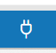

# Visual Studio Code en PlatformIO

In deze sectie lees je hoe je Visual Studio Code (VS Code) en PlatformIO installeert voor het ontwikkelen van microcontrollerprojecten.

## Installeren van Visual Studio Code

1. Ga naar de officiele website: [https://code.visualstudio.com/](https://code.visualstudio.com/).
2. Download de versie voor jouw besturingssysteem.
3. Volg de installatiestappen op het scherm.

## Installeren van de PlatformIO-extensie

1. Open Visual Studio Code.
2. Open Extensions via het zijbalk-icoon of met `Ctrl+Shift+X`.
3. Zoek op `PlatformIO IDE`.
4. Klik op `Install`.

## PlatformIO gebruiken in VS Code

1. Klik na installatie op het PlatformIO-icoon in de zijbalk.
2. Open `PlatformIO Home`.
3. Kies `New Project` om een nieuw project te maken.

## Verkrijgen van de workshopbestanden

Om te starten heb je de workshopbestanden nodig met code, schema's en opdrachtinstructies.

:::::{card}
::::{tab-set}

:::{tab-item} Download ZIP
Download de bestanden als ZIP via:
[Download Workshop Bestanden](https://github.com/AvansMechatronica/RealtimeSoftwareEngineering_workshop/archive/refs/heads/main.zip)

Pak het ZIP-bestand uit in een map die je makkelijk terugvindt.

:::

:::{tab-item} Git Clone

Als je al bekend bent met Git en github, kun je de bestanden ook via Github verkrijgen. Volg de onderstaande stappen:

* Maak een account aan bij [Github](https://github.com/) en login op dit account

* Open de [RealtimeSoftwareEngineering_workshop](https://github.com/AvansMechatronica/RealtimeSoftwareEngineering_workshop) repository

* Maak een Fork van de repository naar je eigen Github account door op het **Fork icoon**  te klikken:


* Volg de instructies, maar wijzig de naam van de nieuwe repository niet. Bevestig met **Create Fork**  

* Nu kun je de workshop clonen naar je lokale machine:

```bash
git clone https://github.com/<jouw_account_naam>/RealtimeSoftwareEngineering_workshop.git
```

:::

::::

:::::

:::{warning}
Plaats de bestanden niet in een `OneDrive`-map. Dit kan compileerproblemen veroorzaken.
:::

## Testen van de installatie
  * Sluit het `NodeMCU32`board of een ESP32-devkit-v1 via een USB kabel aan op de computer. Sluit de `+12V in` aan met een geschikte power-adapter(ingeval van NodeMCU32).

  * Open in visual code de folder/map `<path-to-your-project>/workspace/examples/installatie_validatie`.

  * Compileer en download het programma naar de NodeMCU32 of ESP32-devkit-v1 met de `Upload` knop in de menubalk onder in het scherm


  * Let goed op de mededelingen in de terminal van `Visual Code`, hieraan kun je zien of het uploaden succesvol is verlopen.

  * Als het programma correct is geüpload, zou een LED op de ESP32-board moeten gaan knipperen. Dit is een z.g.n. `hartbeat` LED, welke aangeeft dat het systeem actief is. Deze hartbeat is in alle software van deze course aanwezig. Als de led niet knippert, is de ESP32 mogelijk `vastgelopen` en moet mogelijk opnieuw worden opgestart. Je kunt dit doen met de `RESET` knop op het board.

:::{attention}
Als in de Terminal een vergelijkbare melding verschijnt, zoals hieronder, dan is er een versieconflict is tussen Platformio en de geïnstalleerde ESP32 toolchain
```
IncompatiblePlatform: Development platform 'espressif32' is not compatible with
PlatformIO Core v6.2.0-post.1 and depends on PlatformIO Core >=6.2.0.
```

Volg dan de volgendeinstructies om het conflict op te lossen:
* Open een termenil met de sneltoets `Ctrl+` ` of via het menu `Terminal` -> `New Terminal` in Visual Studio Code.
* Voer het volgende commando uit om de ESP32 toolchain te updaten:

```powershell
& "$env:USERPROFILE\.platformio\penv\Scripts\python.exe" -m pip install --force-reinstall --no-cache-dir --no-deps platformio==6.2.0
```

Controleer of het probleem is opgelost:

```powershell
& "$env:USERPROFILE\.platformio\penv\Scripts\pio.exe" --version
# Expect: PlatformIO Core, version 6.2.0  (no ".post1" suffix)
```

Compileer en upload vervolgens het programma opnieuw naar de ESP32 om te controleren of het conflict is opgelost.
:::


## Gebruik van de monitor & terminal/console
Via een terminal of console kun je de status van het programma volgen.

Open de Terminal. Je kunt deze openen met het volgende icoon aan te klikken:



**Voorbeelden van uitvoer**

Voorbeeld van de programma-uitvoer in Console/Terminal:

*Figuur 1. Console/Terminal terminal window*

```
System initializing
> Heartbeat should be running, flashing onboard LED, pin 2...
FreeRTOS command server
Available commands:
  version    Show firmware information
  cpuinfo    Show ESP32 CPU/chip information
  memory     Show ESP32 heap memory information
  tasks      Show current task snapshot
  help       Show this help
  echo       Echo text, for example: echo hello

```

Tevens kun je nog informatie over de draaiende processen op de ESP32 opvragen d.m.v diverse commado's.

| commando | doel                               |
|----------|------------------------------------|
| version  | Show firmware information          |
| cpuinfo  | Show ESP32 CPU/chip information    |
| memory   | Show ESP32 heap memory information |
| tasks    | Show current task snapshot         |
| help     | Show this help                     |
| echo     | Echo text, for example: echo hello |

Voer als voorbeeld in de Console/Terminal het commando `tasks` uit om de status van alle actieve tasks te bekijken. Je zou nu `tsk_User` in de lijst moeten  zien, met prioriteit 0.

Voorbeeld van `tasks` commando:
```
--- 10 tasks executing ---
Name                 State  Prio  Stack
----------------------------------------
CommandConsole       RUN       1   1328
IDLE0                READY     0    576
IDLE1                READY     0    568
loopTask             BLOCK     1   7244
tsk_Heartbeat        BLOCK     1    860
esp_timer            SUSP     22   8160
Tmr Svc              BLOCK     1   3596
ipc1                 SUSP     24    480
tsk_Printf           BLOCK    23    700
ipc0                 SUSP     24    484
```

